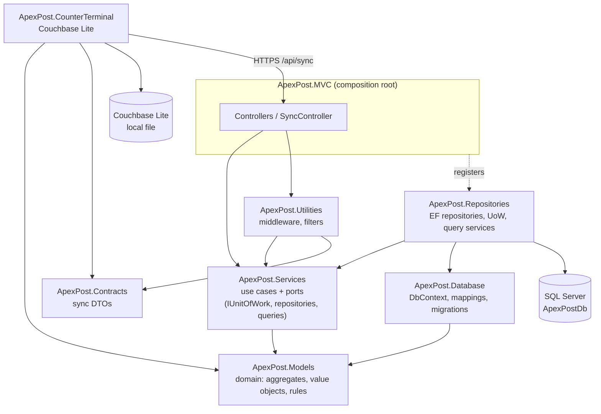
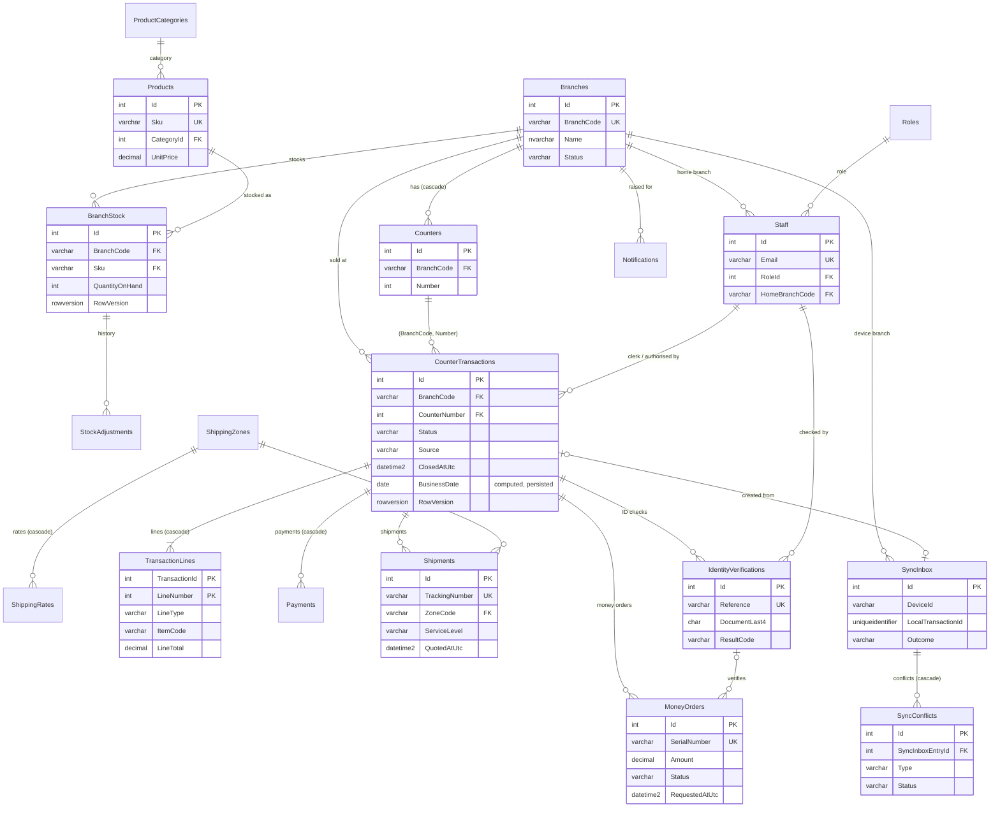
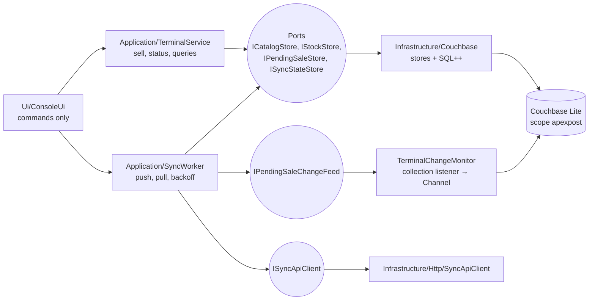

# ApexPost Counter Platform: Design (Week 3)

Week 3 moves ApexPost from JSON files to **SQL Server through EF Core 10**, behind the same
service interfaces, and adds an **offline-first counter terminal** on **Couchbase Lite 4.1** that
syncs with the server when the network returns. The Week 2 design (middleware order, filters,
cookie auth, the Week 2 ADRs) still applies and is kept in [docs/DESIGN-week2.md](docs/DESIGN-week2.md).

Related documents: [README.md](README.md) (setup and run), [PERFORMANCE.md](PERFORMANCE.md)
(indexes and execution plans), [CONFLICTS.md](CONFLICTS.md) (offline conflict policies),
[docs/DEMO.md](docs/DEMO.md) (demo script).

## 1. What changed and what did not

| Concern | Week 2 | Week 3 |
| --- | --- | --- |
| System of record | JSON files + `SemaphoreSlim` | SQL Server `ApexPostDb`, EF Core 10, code-first migrations |
| Domain model | Anemic entities in `ApexPost.Database` | Rich domain in `ApexPost.Models/Domain`: private setters, factories, behaviour, invariants |
| Repositories | Generic `IBaseEntityRepository<T>` | Specific, aggregate-oriented ports (`IStockRepository`, `ICounterTransactionRepository`, ...) owned by the application layer |
| Transactions | One file write per call | **Unit of Work**: one `SaveChanges` per use case; explicit transaction only where a use case spans a set-based update |
| Reads | Load everything, filter in memory | **Query services**: `AsNoTracking` projections to DTOs, `AsSplitQuery`, parameterized raw SQL, 3 stored procedures |
| Concurrency | Process lock | `rowversion` optimistic concurrency + bounded retry; CHECK constraints as the last line of defence |
| Counter offline | Not possible | `ApexPost.CounterTerminal`: Couchbase Lite outbox, change listener, push/pull sync, conflict policies |
| Controllers, middleware, filters, views | | Unchanged in shape. Controllers now receive DTOs, never entities |

The layered flow **Controller → Service → Repository** is unchanged, and the Week 2 business-rule
tests still pass: the same test source file (`ApexPost.Tests/Unit/TransactionRuleTests.cs`) is
compiled twice, once against in-memory fakes and once against SQL Server (§9).

## 2. Project roles

The project names from Week 2 are kept on purpose (ADR-W3-12). Each one maps to a role in the brief:

| Project | Brief role | Contains | References |
| --- | --- | --- | --- |
| `ApexPost.Models` | **Domain** | Aggregates and entities with behaviour (`Branch`, `StaffMember`, `Product`, `BranchStock`, `CounterTransaction`, `Shipment`, `MoneyOrder`, `IdentityVerification`, `SyncInboxEntry`), value objects (`Money`, `Sku`, `BranchCode`, `Weight`, `Dimensions`, `Address`, `MaskedDocumentNumber`), domain exceptions, enums | nothing |
| `ApexPost.Services` | **Application** | Use-case services, the persistence **ports** (`IUnitOfWork`, repositories, query services), DTOs/read models, `OfflineSaleService` | Models |
| `ApexPost.Database` | **Infrastructure: persistence model** | `ApexPostDbContext`, Fluent API configurations, value converters, conventions, interceptors, migrations, seed data, SQL scripts | Models |
| `ApexPost.Repositories` | **Infrastructure: data access** | EF Core repositories, `UnitOfWork`, query services, stored-procedure calls, SQL audit store, historical seeder | Services, Database |
| `ApexPost.Contracts` | **Sync wire contract** | Request/response records for `/api/sync` shared by server and terminal | nothing |
| `ApexPost.Utilities` | **Web infrastructure** | Middleware (incl. device authentication), filters, exception mapping, options | Services, Contracts |
| `ApexPost.MVC` | **Web (composition root)** | `Program.cs`, controllers, views, `SyncController` | everything (composition only) |
| `ApexPost.CounterTerminal` | **Offline terminal** | Console UI, `TerminalService`, `SyncWorker`, Couchbase Lite stores, change monitor, HTTP client | Models, Contracts |
| `ApexPost.Tests` | Unit + web tests | Fakes (in-memory store, spy unit of work), WebApplicationFactory tests | MVC |
| `ApexPost.IntegrationTests` | SQL Server tests | Disposable migrated databases, Week 2 rule tests re-run on SQL | Repositories |
| `ApexPost.CounterTerminal.Tests` | Terminal tests | Real Couchbase Lite databases in temp folders, fake sync API | CounterTerminal |

### Layer diagram (dependencies point inwards)



`ApexPost.Services` never references EF Core: it declares the interfaces and the infrastructure
implements them (Dependency Inversion). `ApexPost.Models` references nothing at all.

## 3. Domain model versus persistence model (ADR-W3-05)

The domain classes are the EF entities for most aggregates, but EF adapts to the domain, not the
other way round:

* **Private setters and factories.** `CounterTransaction.Open(...)`, `Shipment.Create(...)`,
  `MoneyOrder.CreatePending(...)`, `BranchStock.Create(...)`. EF materialises through private
  constructors and fields.
* **Encapsulated collections.** `CounterTransaction` exposes `IReadOnlyCollection<TransactionLine> LineItems`
  backed by `_lines`; EF maps the field (`HasField("_lines")` with field access), so lines can only be
  added through `AddRetailItem`/`AddServiceLine`, which keep the totals right.
* **Value objects through converters.** `Money → decimal(18,2)`, `Sku → varchar(20)`,
  `BranchCode → varchar(10)`, `Weight → decimal(9,3)`, `DateTimeOffset → datetime2(3)` stored as UTC.
  `Address` is an owned type (recipient columns on `Shipments`); `Dimensions` is a complex type.
* **Infrastructure-only columns are shadow properties.** `CreatedAtUtc`, `CreatedBy`,
  `ModifiedAtUtc` (filled by `AuditColumnsInterceptor`) and `RowVersion` never appear in the domain.
* **A separate persistence record where the shapes differ.** `IdentityVerification` (domain) keeps a
  `MaskedDocumentNumber`; the table stores only `DocumentLast4 char(4)` and two-letter codes. The
  repository maps between `IdentityVerification` and `IdentityVerificationRecord`, so a full
  document number has no column to land in. `AuditEntryRecord` and `StockAdjustmentRecord` are
  persistence-only.

Rules live in the domain: `BranchStock.Remove` (never negative, `STOCK_INSUFFICIENT`),
`StaffMember.EnsureCanTransactAt` (inactive staff, wrong branch, role),
`Branch.EnsureOpenForTrading`, `ServiceLevelRules` in `Shipment.Create` (weight limits),
`MoneyOrder.Issue` (identity verification above the threshold), `CounterTransaction.Void/Refund`
(manager + reason). Services orchestrate: load aggregates, call behaviour, commit once.

## 4. Database design

### 4.1 ER diagram



`AuditEntries` (append-only request audit) has no foreign keys by design: audit rows must survive
whatever happens to the rows they describe.

### 4.2 Normalisation (3NF) and the deliberate exceptions

* Every non-key column depends on the key, the whole key and nothing but the key. Roles and
  product categories are lookup tables keyed by the enum value; shipping rates are their own table
  keyed by (zone, type); stock is per (branch, SKU); lines are keyed by (transaction, line number).
* **Natural keys as FK targets.** `BranchCode`, `Sku`, `ZoneCode` and `(BranchCode, Number)` are
  unique alternate keys. Child tables reference them instead of surrogate ids, so a row is readable
  in SSMS without joins and the reporting indexes lead with the column people filter on.
* **Stored totals on `CounterTransactions`** (`Subtotal`, `TaxAmount`, `PassThroughAmount`,
  `TotalAmount`) are derivable from the lines. They are kept because a paid transaction is an
  immutable financial record (the amount charged must never change if a tax rule changes later),
  and `CK_CounterTransactions_Total` guarantees `Total = Subtotal + Tax + PassThrough`.
* **`BusinessDate`** is a persisted computed column (`CONVERT(date, ClosedAtUtc)`): derived, but
  owned by SQL Server, so it cannot disagree with its source, and it makes the daily report SARGable.
* `LineTotal` and `TaxAmount` per line are likewise the price charged at the time.

### 4.3 Constraints

All constraints are named (`PK_`, `FK_`, `UQ_`, `CK_`, `DF_`), so errors and plans are readable:

* **CHECK**: stock `QuantityOnHand >= 0`; positive prices, weights, dimensions, amounts; enum text
  columns limited to their values (`CK_*_Status`, `CK_*_ServiceLevel`, ...); `Closed_HasDate`,
  `Reversal_HasReason` (void/refund needs a reason and an authorising manager);
  `CK_Branches_BranchCode_Format`; `CK_Staff_Email_Format`; the transaction total equation.
* **UNIQUE**: branch code, SKU, staff e-mail, tracking number, money-order serial, verification
  reference, (branch, SKU) stock, (branch, counter number), **(DeviceId, LocalTransactionId)** on
  `SyncInbox` (idempotent sync).
* **DEFAULT**: `SYSUTCDATETIME()` for `CreatedAtUtc`, `'system'` for `CreatedBy`, initial statuses.
* **Delete behaviour (ADR-W3-01)**: master data is never deleted (RESTRICT everywhere); parts of
  an aggregate cascade from their root (counters, rates, lines, payments, conflicts).

### 4.4 Migrations

| Migration | Contents |
| --- | --- |
| `InitialCreate` | 20 tables, all constraints, seed data from the embedded JSON files (`HasData`) |
| `AddReportingIndexes` | The five reporting indexes measured in PERFORMANCE.md |
| `AddStoredProcedures` | `usp_DailyBranchSales`, `usp_LowStockReport`, `usp_AdjustStock`, the `apexpost_app` role |
| `FixInactiveStaffSeed` | Data fix found by the SQL Server tests: `HasData` omits a `false` value for a column with a database default (`DF_Staff_IsActive = 1`), so the inactive demo clerk was seeded as active. The migration sets it back; the in-memory fakes could not reveal this |

`database/schema.sql` is the **idempotent** script (`dotnet ef migrations script --idempotent`).
Procedure bodies are wrapped in `EXEC(N'...')` so they can sit inside the script's
`IF NOT EXISTS (...) BEGIN ... END` blocks. `EnsureCreated` is never used; the web app applies
migrations at start-up only in Development (`Database:MigrateOnStartup`).

## 5. Data access patterns

### 5.1 Unit of Work and repositories

* `IUnitOfWork.SaveChangesAsync` is called **once per use case**. `TransactionService.PayAsync`
  adds the payment, closes the transaction and decrements stock for every line, then commits all
  of it in one `SaveChanges` (one database transaction). If any rule fails, nothing has been
  written. The spy unit of work in the unit tests asserts "exactly one commit" and "no commit on
  failure"; the SQL integration tests assert the rollback for real.
* `ExecuteInTransactionAsync` is used only when a use case needs a set-based statement plus
  tracked changes (`CatalogService.RevisePricesAsync` uses `ExecuteUpdate` on prices inside the
  execution strategy's transaction).
* Repositories are **specific**: `IStockRepository.GetForUpdateAsync(branch, skus)` loads exactly
  the rows a sale needs in one query; `ISyncInboxRepository.FindAsync(device, localId)` backs idempotency.
* `UnitOfWork` translates provider errors into domain language: `DbUpdateConcurrencyException`
  becomes `ConcurrencyConflictException` (HTTP **409**), unique-key violations 2601/2627 become
  `DuplicateKeyException`, a CHECK violation becomes a `BusinessRuleViolationException`.

### 5.2 Concurrency (ADR-W3-06)

`BranchStock` and `CounterTransactions` carry a `rowversion`. Two clerks selling the last parcel
bag both read version N; the first commit wins, the second gets a concurrency conflict.
`ConcurrencyRetry` discards the losing context's changes, reloads and re-runs the use case
(bounded by `BusinessRules:ConcurrencyRetryAttempts`), so the second clerk now sees zero stock and
gets `STOCK_INSUFFICIENT` instead of overselling. The integration test
`Parallel_clerks_never_oversell_thanks_to_retry_on_conflict` runs 8 parallel deductions against 5
units and asserts exactly 5 succeed. The `CK_BranchStock_QuantityOnHand_NonNegative` constraint is the
backstop if code ever bypasses the domain.

### 5.3 Reads: query services and DTOs

Controllers and views receive **DTOs only** (`TransactionSummaryDto`, `StockDto`, ...). Query
services project directly from `IQueryable` with `AsNoTracking`, so only the needed columns are
read and no change tracking is paid for. `GetDetailsAsync` uses `AsSplitQuery` for the multi-collection
transaction detail (EF's `MultipleCollectionIncludeWarning` is configured to **throw**, so an
accidental cartesian explosion fails in tests). The N+1 guard test counts SQL commands with an
interceptor: listing 50 recent transactions is one command.

### 5.4 Raw SQL and stored procedures (ADR-W3-03)

All raw SQL uses `FormattableString` APIs (`SqlQuery<T>($"...")`, `ExecuteSqlAsync($"...")`), so
every interpolated value becomes a `SqlParameter`. Nothing is concatenated.

| Procedure | Why a procedure | Called from |
| --- | --- | --- |
| `usp_DailyBranchSales` | Fixed report contract shared by the dashboard and finance; conditional aggregate tuned once on the `BusinessDate` index | `ReportQueries.GetBranchSalesSplitAsync` |
| `usp_LowStockReport` | Optional parameters; `OPTION (RECOMPILE)` lets the optimizer seek for one branch and scan for all (trade-off documented in the procedure) | `ReportQueries.GetLowStockAsync` |
| `usp_AdjustStock` | Read-check-write plus history insert must be atomic under concurrency: `XACT_ABORT`, `UPDLOCK, HOLDLOCK`, `TRY/CATCH`, `THROW 50001/50002/50003` mapped to domain exceptions | `StockAdjustmentProcedure` → `InventoryService.AdjustAsync` |

The web app's database user should be a member of `apexpost_app` (created by the migration):
`EXECUTE` on the three procedures plus `SELECT/INSERT/UPDATE` on the tables, no DDL.

### 5.5 DI lifetimes (ADR-W3-04)

`ApexPostDbContext`, every repository, every query service and the unit of work are **scoped**
(one per request, shared by all services in that request). Nothing singleton holds a context:
`CachingService` (singleton) creates a scope through `IServiceScopeFactory` when it refreshes, and
`SqlAuditStore` (singleton) uses its own `IDbContextFactory` that creates short-lived contexts
(ADR-W3-07). `ValidateScopes` and `ValidateOnBuild` are on in tests, so a captive dependency
fails the build of the container.

## 6. Offline counter terminal

### 6.1 Terminal architecture



Couchbase types never appear above `Infrastructure`. The terminal reuses the shared value
objects (`Money`, `Sku`, `BranchCode`) and the wire contracts, not the server's services.

### 6.2 Local data model

Scope `apexpost`, four collections. Every document has `type` and `schemaVersion`; money is stored as
integer **cents** (Couchbase Lite has no decimal type); times are ISO-8601 UTC strings so they sort
and compare correctly in SQL++.

| Collection | Document id | Owner | Content |
| --- | --- | --- | --- |
| `catalog` | `product::{Sku}` | server | name, category, `priceCents`, tax category, active |
| `stock` | `stock::{Branch}::{Sku}` | mixed (field level) | server: `serverQuantity`, `reorderThreshold`, `serverSyncedAt`; device: `localSoldSinceSync`, `lastLocalSaleAt` |
| `pendingTransactions` | `tx::{DeviceId}::{Guid}` | device | the sale (lines, money orders, payment method, `capturedAt`, `businessDate`, `totalCents`) and its sync status, attempts, last error, warnings, server id |
| `syncState` | `syncstate::{DeviceId}` | device | online flag, last successful sync, last snapshot time, last error |

Document ids are unique without the server (device id + GUID). No identity document numbers, card
numbers or customer identity data are stored on the terminal (a test asserts it).

Value indexes: `catalog(type, category, name)`, `pendingTransactions(type, status, capturedAt)`,
`pendingTransactions(type, businessDate)`. Parameterized SQL++ queries (`$category`, `$status`,
`$cutoff`, `$today`): products by category ordered by name; pending sales older than N minutes;
today's sales count and total; pending count. A test proves that a quote in a parameter is data,
not query text.

### 6.3 Sync sequence (ADR-W3-08)

```mermaid
sequenceDiagram
    autonumber
    participant Clerk
    participant T as TerminalService
    participant L as Couchbase Lite
    participant M as Change monitor
    participant W as SyncWorker
    participant API as /api/sync (HTTPS)
    participant S as OfflineSaleService
    participant DB as SQL Server

    Clerk->>T: sell STA-001 x2 (network down)
    T->>L: save tx::TERM::guid (Pending)   [outbox first]
    T->>L: stock.localSoldSinceSync += 2
    L-->>M: collection change (doc ids only)
    M-->>W: wake (Channel)
    W->>API: POST transactions [batch ≤ 50]
    API--xW: network error
    W->>L: attempts++, lastError, stays Pending; backoff 2^n s + jitter
    Note over W: network returns
    W->>API: POST transactions (X-Device-Id, X-Device-Key)
    API->>S: RecordAsync(command) per sale
    S->>DB: SyncInbox lookup (DeviceId, LocalTransactionId)
    S->>DB: ONE SaveChanges: inbox row + transaction + lines + payment + stock + conflicts
    API-->>W: Accepted / AcceptedWithWarnings / Rejected (+ Duplicate flag)
    W->>L: Synced (server id, warnings) or Rejected; move units to server quantity
    W->>API: GET branch-snapshot?since=lastSnapshotAt
    API-->>W: products, prices, stock for the device's branch
    W->>L: upsert catalog; field-level merge of stock; syncState.lastSuccessfulSyncAt
```

Why an application-level outbox over HTTPS instead of Couchbase Sync Gateway: the system of
record is SQL Server, and every offline sale must go through the **same domain rules and the
same unit of work** as a sale at a live counter (staff checks, branch checks, money-order rules,
stock, tax). Pushing documents into a document store would bypass all of that. The outbox needs
only the existing web app, device keys and one controller.

Failure handling:

* The sale is written locally **before** any network call; a network failure never loses a sale.
* A lost response (server committed, client timed out) is safe: the retry hits the unique
  `(DeviceId, LocalTransactionId)` and gets the original result with `Duplicate = true`. Two pushes
  racing each other are resolved by the unique index (`DuplicateKeyException` → return the
  winner's result). Tests cover both, in memory and on SQL Server.
* 5xx, 429, timeouts and 401/403 keep the sale `Pending` and back off exponentially
  (2, 4, 8, ... capped at `MaxBackoffSeconds`, plus up to 25% jitter so a fleet of terminals does
  not retry in lock-step). A successful sync resets the delay.
* `Rejected` sales (unknown clerk, high-value money order) are not retried; their units are given
  back to local stock and they appear in `pending`/`show` for a supervisor.

### 6.4 Change listener (ADR-W3-09)

`TerminalChangeMonitor` adds **one** listener to `pendingTransactions` (a second `Start()` is a
no-op; `Registrations` is asserted in a test). The callback only copies document ids into an
unbounded `Channel<string>`; it does no I/O and no business logic, so it cannot block Couchbase
Lite's notification thread. `SyncWorker.RunLoopAsync` awaits the channel (or the interval/backoff,
whichever comes first). On shutdown the monitor is disposed **before** the database, and
`Dispose` calls `token.Remove()`.

### 6.5 Offline business rules (ADR-W3-10)

* Stock cannot go negative against the local snapshot: `Available = serverQuantity − localSoldSinceSync`.
  Repeated SKUs in one basket are combined before the check.
* The sale is priced from the local catalogue snapshot (conflict policy C1 on the server).
* Money orders above the identity threshold (default $1,000) are **blocked while offline**
  (`MONEY_ORDER_BLOCKED_OFFLINE`): the identity check must be recorded online in the same
  transaction. Online, the light terminal still sends them to a full counter
  (`MONEY_ORDER_ID_REQUIRED`). The server rejects them too if a modified terminal sends one.
* Conflict policies for what happens on the server are in [CONFLICTS.md](CONFLICTS.md).

### 6.6 Security of the sync API

`/api/sync/*` is HTTPS only, anonymous to cookies but authenticated by
`DeviceAuthenticationMiddleware`: `X-Device-Id` + `X-Device-Key`, compared as SHA-256 hashes with
`CryptographicOperations.FixedTimeEquals` against `Sync:Devices:{id}:Key` (user-secrets /
environment, never `appsettings.json`). Each device is **bound to one branch**; the branch in a
push is taken from the device registration, not from the payload. Requests are rate limited per
device (`Sync:RequestsPerMinute`, 429), batches are capped (`MaxSalesPerPush`), errors are Problem
Details, and the clerk id in each sale is re-validated against the branch.

## 7. Security summary

| Requirement | How |
| --- | --- |
| No secrets in source control | Connection string, partner keys and device keys in user-secrets (`ApexPost.MVC`, `ApexPost.CounterTerminal`) or environment variables; `appsettings.json` holds empty placeholders |
| No string-concatenated SQL | EF LINQ, `SqlQuery`/`ExecuteSqlAsync` with `FormattableString`, `SqlParameter` in scripts, `$parameters` in SQL++; dynamic DDL in test/perf scripts uses `QUOTENAME(@name)` server-side |
| Identity documents masked everywhere | Domain keeps `MaskedDocumentNumber`; table has only `DocumentLast4`; audit filter whitelists fields; terminal never stores identity data; tests search SQL, audit and Couchbase for the full number |
| Least privilege | `apexpost_app` role: EXECUTE on 3 procedures, DML on tables, no DDL |
| Fictional data | Seed, historical generator and perf generator produce invented names and amounts only |

## 8. Architecture Decision Records (Week 3)

### ADR-W3-01: Restrict deletes on master data, cascade only inside aggregates
**Context**: sales, shipments and audit must never lose their parent. **Decision**: RESTRICT on every
FK to branches, staff, products, zones; CASCADE only from an aggregate root to parts that cannot
exist alone (counters, rates, lines, payments, conflicts). Closing a branch is a status change.
**Consequences**: no accidental history loss; "delete" in the UI means deactivate.

### ADR-W3-02: Five targeted reporting indexes, measured before and after
**Context**: dashboard and reports filter by branch + date, zone + level + date, and branch + month.
**Decision**: a persisted `BusinessDate` column with `(BranchCode, BusinessDate) INCLUDE (totals)`;
a filtered `(ClosedAtUtc) WHERE Status='Paid'` index; `(ZoneCode, ServiceLevel, QuotedAtUtc DESC)`
covering; filtered money-order audit index; covering branch-stock index. Queries were rewritten to
be SARGable (range instead of `YEAR()`/`MONTH()`). **Consequences**: logical reads fell 99.0–99.9% on the four reporting workloads (PERFORMANCE.md
§4); every "before" plan's missing-index hint disappears; extra write cost on inserts is the price,
accepted because the hot path touches only two of the indexes.

### ADR-W3-03: Stored procedures only where they earn their place
**Context**: the brief asks for three procedures; EF LINQ covers most queries. **Decision**: a fixed
report contract, an optional-parameter report with `OPTION (RECOMPILE)`, and an atomic
read-check-write (`usp_AdjustStock`). Everything else stays in LINQ. Procedures ship in a migration
and are called only with parameters. **Consequences**: three places where SQL is the source of
truth, each documented in its header comment.

### ADR-W3-04: Scoped DbContext, repositories and unit of work
**Decision**: one context per request; no singleton captures a context; singletons that need data
create a scope or use a context factory. **Consequences**: no cross-request tracking leaks, no
thread-safety issues, `ValidateScopes` enforces it.

### ADR-W3-05: Rich domain mapped by EF, separate records where shapes differ
**Decision**: domain classes are EF entities through private setters, backing fields, converters,
owned/complex types and shadow properties; identity verifications and audit entries use separate
persistence records. **Consequences**: invariants cannot be bypassed by setting properties; a few
mapping helpers to maintain.

### ADR-W3-06: Optimistic concurrency with rowversion and bounded retry
**Decision**: `rowversion` on stock and transactions; `ConcurrencyRetry` reloads and re-runs the
use case; CHECK constraints as a backstop. **Alternatives**: pessimistic locks for every sale
(rejected: blocks the counter under load); used only inside `usp_AdjustStock`. **Consequences**:
no overselling, measured by a parallel test.

### ADR-W3-07: Audit writes outside the request's unit of work
**Decision**: `SqlAuditStore` writes through a separate short-lived context. **Why**: a rejected or
failed request must still be audited, and the audit row must not be rolled back with the use case.

### ADR-W3-08: Application-level outbox over HTTPS for offline sync
**Decision**: the terminal keeps a Couchbase Lite outbox and pushes to `/api/sync/transactions`;
the server applies each sale through `OfflineSaleService` (domain rules + one commit) with an
idempotency inbox. Pull is a snapshot endpoint. **Alternatives**: Sync Gateway / Couchbase Server
replication (rejected: bypasses SQL Server rules, adds infrastructure). **Consequences**: simple
operations, at-least-once delivery made exactly-once by the unique inbox key.

### ADR-W3-09: Change listener only signals; work happens in the worker
**Decision**: one listener, ids into a channel, removed before close. **Consequences**: no blocking
of Couchbase Lite's thread, no duplicate registrations, clean shutdown.

### ADR-W3-10: High-value money orders are online-only
**Decision**: block above the identity threshold on the terminal and reject on the server.
**Why**: anti-money-laundering control requires a recorded identity check in the same
transaction; an offline device cannot provide that. **Consequences**: offline counters can still
sell low-value money orders.

### ADR-W3-11: Offline conflicts are accepted and flagged, never silently dropped
**Decision**: C1 honour the offline price and flag variance above 5%; C2 accept the sale, stop stock at
zero, record a `StockShortfall` conflict and notify the manager; C3 the device never sends
server-owned fields. **Why**: the customer has already paid and left; rejecting would make the
books disagree with reality. Details and alternatives in CONFLICTS.md.

### ADR-W3-12: Keep the Week 2 project names
**Decision**: keep `ApexPost.Models/Services/Database/Repositories/Utilities/MVC` and document
their roles (§2) instead of renaming to Domain/Application/Infrastructure/Web. **Why**: the
dependency rules are what make the architecture clean, not the folder names; a rename would touch
every file and hide the real changes in review. **Consequences**: readers need the mapping table.

## 9. SOLID mapping

| Principle | Where |
| --- | --- |
| **S**ingle responsibility | `TerminalService` (counter use cases) vs `SyncWorker` (sync) vs `ConsoleUi` (I/O); query services (reads) vs repositories (writes); `UnitOfWork` (commit + error translation) |
| **O**pen/closed | New conflict types are new `SyncConflictType` values handled in one service; pricing strategies and EF configurations are added as new classes, not edits to a switch |
| **L**iskov | `SpyUnitOfWork`/`InMemoryStore` fakes and the EF implementations satisfy the same ports, so the same Week 2 rule tests pass on both |
| **I**nterface segregation | Small ports: `IStockRepository`, `IStockAdjustmentProcedure`, `ISyncInboxRepository`, `IPendingSaleChangeFeed`, `INetworkSwitch` instead of one generic repository |
| **D**ependency inversion | `ApexPost.Services` owns the interfaces; `ApexPost.Repositories` and the terminal's `Infrastructure` implement them; composition roots wire them |

## 10. Testing strategy

| Project | What it proves | Needs |
| --- | --- | --- |
| `ApexPost.Tests` (129) | Week 2 rules on fakes; the real terminal syncing with the real web app in memory (offline sale → reconnect → duplicate push); one commit per use case, none on failure; offline idempotency and C1/C2/C3; `/api/sync` auth, branch binding, 400/401/429 Problem Details; model snapshot matches migrations | nothing |
| `ApexPost.CounterTerminal.Tests` (31) | Couchbase CRUD, SQL++ (incl. injection attempt), persistence across reopen, field-level merge, listener once, offline rules, sync worker with network failure, lost response, rejection, backoff | nothing (real Couchbase Lite in a temp folder) |
| `ApexPost.IntegrationTests` (27) | Week 2 rule tests on SQL Server; migrations; aggregate round trip; rollback; rowversion conflict; parallel clerks; CHECK; masking; three procedures + error mapping; racing pushes; N+1 command count; `ToQueryString` | SQL Server / LocalDB (`APEXPOST_TEST_SQL`) |

## 11. Known limitations

* The terminal has no local sign-in; the clerk id comes from configuration. A production terminal
  would cache staff credentials (hashes) in the snapshot.
* Snapshot pulls are deltas based on the audit columns (`CreatedAtUtc`/`ModifiedAtUtc` after the
  terminal's last `GeneratedAtUtc`); very large catalogues would need paging, and a row committed in
  the same millisecond as the snapshot could be picked up one sync later.
* Sales flagged with conflicts are visible in **Reports → Sync conflicts**; resolving them is a
  manual process (no workflow screen).
